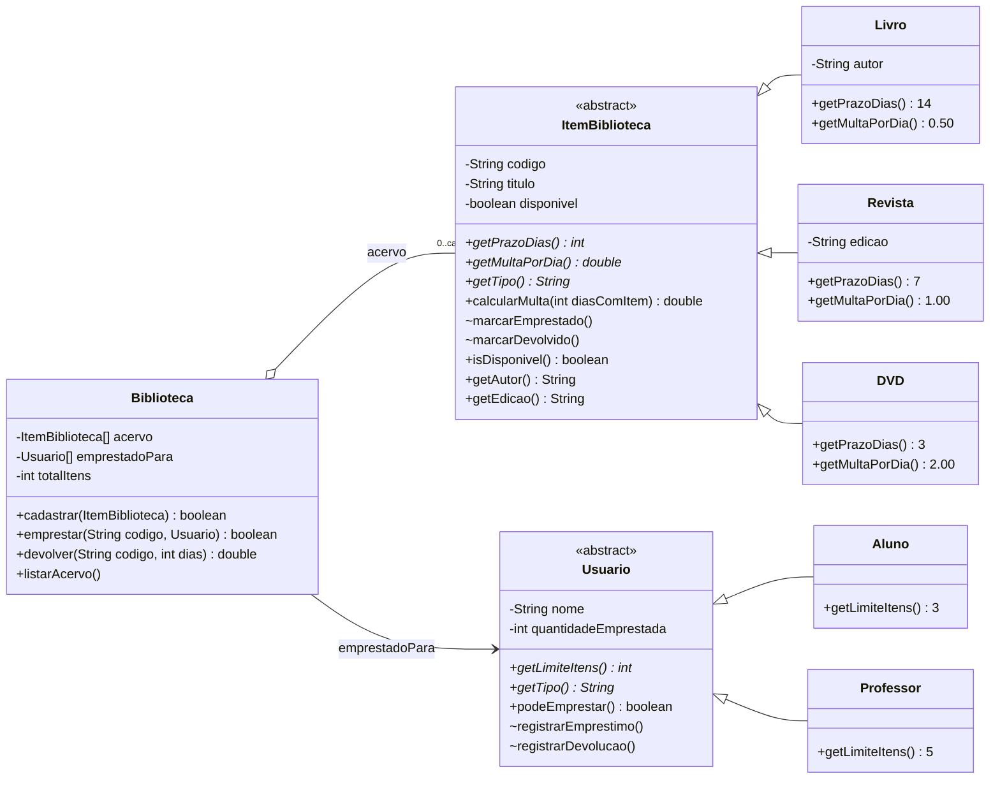
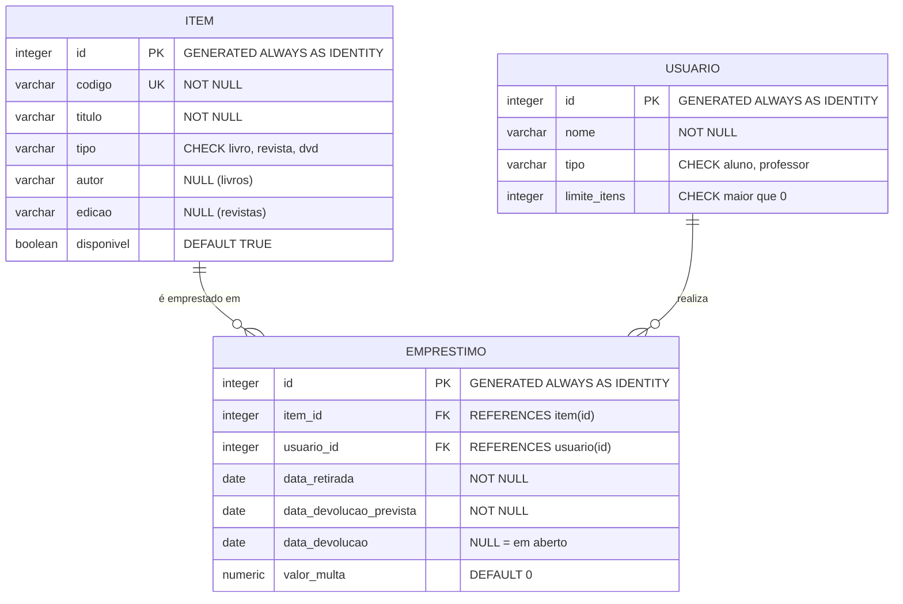
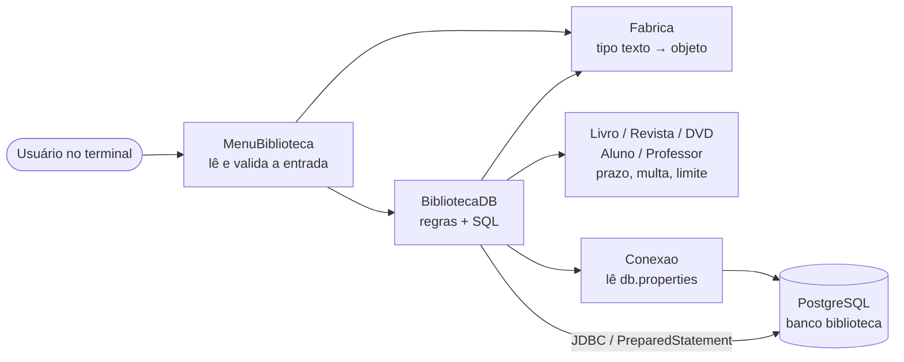

# 📚 Biblioteca de Bairro: Java + PostgreSQL

Sistema de controle de acervo (livros, revistas e DVDs) emprestado a alunos e professores.
O repositório reúne três exercícios que se complementam:

| Exercício | Tema | Onde está |
|---|---|---|
| **1** | Modelagem orientada a objetos em Java (classes abstratas, herança, polimorfismo) | `src/biblioteca/` |
| **2** | Modelagem relacional no PostgreSQL (tabelas, chaves, restrições, dados de teste) | `sql/biblioteca.sql` |
| **3** | Consultas SQL (JOIN, GROUP BY, LEFT JOIN … IS NULL) | `sql/consultas.sql` |
| Extra | Menu interativo no terminal ligado ao banco via **JDBC** | `src/biblioteca/MenuBiblioteca.java` |

**Regras de negócio**

| | Prazo | Multa por dia de atraso | | Limite de itens simultâneos |
|---|---|---|---|---|
| Livro | 14 dias | R$ 0,50 | Aluno | 3 |
| Revista | 7 dias | R$ 1,00 | Professor | 5 |
| DVD *(categoria nova, item 10)* | 3 dias | R$ 2,00 | | |

---

## Sumário

1. [Tecnologias e versões](#-tecnologias-e-versões)
2. [Estrutura do repositório](#-estrutura-do-repositório)
3. [Como rodar na sua máquina](#-como-rodar-na-sua-máquina)
4. [Exercício 1: Java orientado a objetos](#-exercício-1--java-orientado-a-objetos)
5. [Exercício 2: Modelagem do banco](#-exercício-2--modelagem-do-banco)
6. [Exercício 3: Consultas SQL](#-exercício-3--consultas-sql)
7. [Extra: integração Java ↔ PostgreSQL (JDBC)](#-extra--integração-java--postgresql-jdbc)
8. [Onde cada requisito foi atendido](#-onde-cada-requisito-foi-atendido)
9. [Problemas comuns](#-problemas-comuns)

---

## 🧰 Tecnologias e versões

| Tecnologia | Versão | Observação |
|---|---|---|
| Java (JDK) | **11 ou superior** | Código compatível com Java 11. Desenvolvido e testado com o JDK 26 no Eclipse. |
| PostgreSQL | **10 ou superior** | `GENERATED ALWAYS AS IDENTITY` exige PG 10+. Testado no PostgreSQL 16. |
| pgAdmin 4 | qualquer versão recente | Opcional: dá para usar só o `psql`. |
| Driver JDBC PostgreSQL (pgJDBC) | **42.7.13** | Já incluído em `lib/`, não precisa baixar. |
| JUnit | **5 (Jupiter)** | Já vem com o Eclipse (*JUnit 5 container* no build path). |
| IDE | Eclipse IDE for Java Developers | O repositório já tem `.project` e `.classpath`. Outras IDEs funcionam adicionando `lib/` ao classpath. |

Não há Maven nem Gradle: o projeto é um projeto Java "puro" do Eclipse, para ficar simples de abrir.

---

## 🗂 Estrutura do repositório

```
Biblioteca-MaisPraTi/
├── README.md
├── .gitignore                  ← ignora compilados e o db.properties (senha)
├── db.properties.example       ← modelo de configuração da conexão
├── .project / .classpath       ← configuração do projeto no Eclipse
├── lib/
│   └── postgresql-42.7.13.jar  ← driver JDBC
├── sql/
│   ├── biblioteca.sql          ← Ex. 2: CREATE TABLE + dados de teste
│   └── consultas.sql           ← Ex. 3: as quatro consultas
├── src/biblioteca/
│   ├── ItemBiblioteca.java     ← Ex. 1: classe abstrata do item
│   ├── Livro.java  Revista.java  DVD.java
│   ├── Usuario.java            ← Ex. 1: classe abstrata do usuário
│   ├── Aluno.java  Professor.java
│   ├── Biblioteca.java         ← Ex. 1: emprestar/devolver/listar com arrays fixos
│   ├── Main.java               ← Ex. 1: cenário de teste (item 6)
│   ├── Fabrica.java            ← extra: texto "tipo" → objeto
│   ├── Conexao.java            ← extra: abre a conexão JDBC
│   ├── BibliotecaDB.java       ← extra: mesmas operações gravando no PostgreSQL
│   └── MenuBiblioteca.java     ← extra: menu interativo no terminal
└── test/biblioteca/            ← testes JUnit 5 (21 testes)
    ├── ItemBibliotecaTest.java
    ├── UsuarioTest.java
    └── BibliotecaTest.java
```

---

## 🚀 Como rodar na sua máquina

### Pré-requisitos

- JDK 11+ instalado
- PostgreSQL 10+ instalado e rodando (porta padrão `5432`)
- Eclipse IDE for Java Developers (recomendado) e/ou pgAdmin 4

### 1. Clonar

```bash
git clone https://github.com/<seu-usuario>/Biblioteca-MaisPraTi.git
cd Biblioteca-MaisPraTi
```

### 2. Criar o banco e carregar os dados (Exercício 2)

**Opção A: pgAdmin**

1. Conecte no servidor, clique com o botão direito em **Databases → Create → Database…**, dê o nome `biblioteca` e salve.
2. Clique no banco `biblioteca` → **Tools → Query Tool**.
3. Abra o arquivo `sql/biblioteca.sql` (ícone de pasta ou `Ctrl+O`) e execute tudo (`F5`).
4. Em **biblioteca → Schemas → public → Tables** devem aparecer `item`, `usuario` e `emprestimo` (clique em *Refresh* se não aparecerem).

**Opção B: terminal (`psql`)**

```bash
psql -U postgres -c "CREATE DATABASE biblioteca"
psql -U postgres -d biblioteca -f sql/biblioteca.sql
```

> O script é **reexecutável**: ele apaga e recria as três tabelas, então pode ser rodado de novo sempre que quiser voltar aos dados de teste.

### 3. Rodar as consultas (Exercício 3)

- **pgAdmin:** no Query Tool do banco `biblioteca`, abra `sql/consultas.sql`, **selecione uma consulta** e aperte `F5`. Se executar o arquivo inteiro, o pgAdmin mostra só o resultado da última.
- **psql:** `psql -U postgres -d biblioteca -f sql/consultas.sql` mostra as quatro em sequência.

Os resultados esperados estão na seção do [Exercício 3](#-exercício-3--consultas-sql).

### 4. Configurar a conexão do Java

Copie o modelo e coloque a **sua** senha do PostgreSQL:

```bash
# Windows (cmd)
copy db.properties.example db.properties
# Linux / macOS
cp db.properties.example db.properties
```

```properties
url=jdbc:postgresql://localhost:5432/biblioteca
usuario=postgres
senha=SUA_SENHA_AQUI
```

O `db.properties` está no `.gitignore`: **a senha nunca vai para o GitHub**.

### 5. Abrir no Eclipse

1. **File → Import… → General → Existing Projects into Workspace → Next**.
2. Em *Select root directory*, escolha a pasta clonada `Biblioteca-MaisPraTi` → **Finish**.
3. Se o Eclipse acusar JRE, clique com o botão direito no projeto → **Build Path → Configure Build Path → Libraries** e confira se há um JDK 11+ e o **JUnit 5**. O driver `lib/postgresql-42.7.13.jar` já está configurado.

### 6. Executar

| O que | Como | Precisa do banco? |
|---|---|---|
| Cenário de teste do Ex. 1 | botão direito em `Main.java` → **Run As → Java Application** | Não |
| Menu interativo (CRUD no banco) | botão direito em `MenuBiblioteca.java` → **Run As → Java Application**, depois clique no **Console** e digite as opções | Sim |
| Testes automatizados | botão direito na pasta `test` → **Run As → JUnit Test** (esperado: **21/21 verdes**) | Não |

> Se o banco `biblioteca` ainda não existir, o `MenuBiblioteca` **cria o banco e as tabelas sozinho** na primeira execução (usando `sql/biblioteca.sql`).

### Alternativa: sem Eclipse (linha de comando)

Execute a partir da raiz do repositório:

```bash
# Linux / macOS
javac -encoding UTF-8 -cp lib/postgresql-42.7.13.jar -d out src/biblioteca/*.java
java -cp out biblioteca.Main
java -cp out:lib/postgresql-42.7.13.jar biblioteca.MenuBiblioteca
```

```bat
:: Windows (cmd): o separador do classpath é ";"
javac -encoding UTF-8 -cp lib\postgresql-42.7.13.jar -d out src\biblioteca\*.java
java -cp out biblioteca.Main
java -cp out;lib\postgresql-42.7.13.jar biblioteca.MenuBiblioteca
```

---

## ☕ Exercício 1: Java orientado a objetos

### Diagrama de classes



Legenda: `*` = método abstrato · `~` = visível só no pacote (*package-private*) · `-` privado · `+` público.

### Conceitos aplicados

- **Abstração:** `ItemBiblioteca` e `Usuario` são `abstract`. Não existe "um item qualquer" nem "um usuário qualquer": todo objeto é concretamente um `Livro`, uma `Revista`, um `Aluno` etc.
- **Herança:** os dados e comportamentos comuns (código, título, disponibilidade, cálculo de multa) ficam na superclasse. As subclasses só dizem o que muda.
- **Polimorfismo:** `Biblioteca` trabalha apenas com `ItemBiblioteca` e `Usuario`. Quando chama `item.getPrazoDias()` ou `usuario.getLimiteItens()`, o Java executa a versão da subclasse real, sem nenhum `if`/`instanceof`.
- **Encapsulamento:** atributos `private`. O estado só muda por operações com significado de negócio (`emprestar`, `devolver`), nunca por *setters* genéricos.

### Decisões técnicas

| Decisão | Por quê |
|---|---|
| **Prazo e multa são métodos abstratos, não atributos** (item 7) | São características do *tipo*, não de cada objeto. Como atributos, cada `new Livro(...)` poderia receber um prazo diferente, e o tipo deixaria de garantir a regra. Como métodos abstratos, o compilador obriga toda nova categoria a definir os dois. |
| **`calcularMulta()` é concreto na superclasse** | A *fórmula* é igual para todos (`dias de atraso × multa por dia`). Só os *parâmetros* variam. É o padrão *Template Method*: a superclasse define o algoritmo e as subclasses fornecem os valores. |
| **Sem `setDisponivel()` público** (item 8) | `marcarEmprestado()`/`marcarDevolvido()` são *package-private*: só a `Biblioteca` (mesmo pacote) consegue chamá-los, e só dentro de `emprestar()` e `devolver()`. Assim é impossível um item ficar "indisponível" sem um empréstimo correspondente. O mesmo vale para `quantidadeEmprestada` em `Usuario`. |
| **Arrays de tamanho fixo** (item 5) | `acervo` e `emprestadoPara` são criados com a capacidade informada no construtor. `emprestadoPara[i]` guarda quem está com `acervo[i]` (arrays paralelos), o que permite à `devolver()` saber de quem descontar o item. `cadastrar()` recusa quando o acervo está cheio. |
| **`listarAcervo()` em um único laço, sem `if` de tipo** (item 9) | O laço só chama `System.out.println(acervo[i])`. O `toString()` da superclasse usa `getTipo()`, `getPrazoDias()` e `getMultaPorDia()`, todos polimórficos. |
| **`devolver()` recebe os dias com o item e retorna a multa** | Mantém o Exercício 1 sem dependência de datas/relógio, o que facilita testar (`devolver("R01", 10)` → R$ 3,00). Na versão com banco, os dias são calculados a partir das datas reais. |
| **Categoria nova `DVD` sem alterar nada** (item 10) | Bastou criar `DVD extends ItemBiblioteca` com 3 métodos. `Biblioteca`, `emprestar`, `devolver` e `listarAcervo` funcionaram sem nenhuma alteração, prova de que a decisão de tipo não "vazou" para a lógica de negócio. |

### Saída do cenário de teste (`Main`)

```
OK: "Dom Casmurro" emprestado para Ana. Devolver em 14 dias.
OK: "Superinteressante - Out/2026" emprestado para Ana. Devolver em 7 dias.
OK: "Central do Brasil" emprestado para Ana. Devolver em 3 dias.
Ana (Aluno) 3/3 itens
RECUSADO: Ana atingiu o limite de 3 itens (Aluno).        ← recusado por limite
OK: "O Cortiço" emprestado para Prof. Carlos. Devolver em 14 dias.
...
Devolvido: "Dom Casmurro" por Ana após 10 dias. Multa: R$ 0,00
Devolvido: "Superinteressante - Out/2026" por Ana após 10 dias. Multa: R$ 3,00
Devolvido: "Central do Brasil" por Ana após 5 dias. Multa: R$ 4,00
```

### Testes (JUnit 5): 21 testes

- `ItemBibliotecaTest`: prazo e multa de cada tipo, multa zero dentro do prazo/no último dia, multa com atraso, DVD funcionando pelo polimorfismo.
- `UsuarioTest`: limites de aluno (3) e professor (5), bloqueio ao atingir o limite.
- `BibliotecaTest`: empréstimo bem-sucedido, recusa por limite, item já emprestado, código inexistente, devolução no prazo e atrasada, devolução inválida, devolução liberando novo empréstimo, acervo cheio.

---

## 🐘 Exercício 2: Modelagem do banco

### Diagrama entidade-relacionamento



Um item pode aparecer em vários empréstimos ao longo do tempo (histórico), e um usuário pode ter vários empréstimos. `emprestimo` é a tabela que liga os dois (relacionamento N:N com atributos próprios: datas e multa).

### Da herança (Java) para tabelas (SQL)

O banco relacional não tem herança. A estratégia usada é **uma tabela por hierarquia** (*single table*): todos os tipos de item ficam na tabela `item`, diferenciados pela coluna `tipo`.

| Java | PostgreSQL |
|---|---|
| `Livro`, `Revista`, `DVD extends ItemBiblioteca` | tabela `item` + coluna `tipo` com `CHECK` |
| `Aluno`, `Professor extends Usuario` | tabela `usuario` + coluna `tipo` com `CHECK` |
| `getLimiteItens()` abstrato | coluna `limite_itens` (gravada a partir do objeto) |
| atributo só de `Livro` (autor) / só de `Revista` (edição) | colunas `autor` e `edicao` que aceitam `NULL` |
| array paralelo `emprestadoPara[]` | tabela `emprestimo` (com histórico completo) |
| `devolver(codigo, dias)` | `data_retirada`, `data_devolucao_prevista`, `data_devolucao` |

### Decisões técnicas

| Decisão | Por quê |
|---|---|
| **`GENERATED ALWAYS AS IDENTITY`** (item 16) | Forma padrão SQL e moderna de autoincremento no PostgreSQL. Diferente de `SERIAL`, a sequência pertence à coluna, e o `ALWAYS` impede inserir um id "na mão" por engano. |
| **`CHECK (tipo IN (...))`** nas duas tabelas (item 17) | Como não há herança, é o banco quem garante que só existam tipos válidos. Um `INSERT` com `tipo = 'cd'` é rejeitado. |
| **Chaves estrangeiras** `REFERENCES item(id)` / `usuario(id)` (item 18) | Impedem empréstimo de item ou usuário inexistente e impedem apagar um item/usuário que tem histórico de empréstimos. |
| **`data_devolucao` sem `NOT NULL`** (item 19) | `NULL` significa "ainda não devolvido". É assim que se identifica um empréstimo em aberto. |
| **Ordem dos `CREATE TABLE`** (itens 14 e 20) | `item` → `usuario` → `emprestimo`, porque `emprestimo` referencia as outras duas. Os `DROP` no início do script seguem a ordem inversa. |
| **`codigo UNIQUE`** | O código é o identificador de negócio (ex.: `L01`), usado pelo Java para buscar itens. |
| **Índice único parcial** `ON emprestimo(item_id) WHERE data_devolucao IS NULL` | Garante no próprio banco que um item não tenha dois empréstimos em aberto ao mesmo tempo. |
| **`CHECK` de datas** | Devolução prevista e devolução real não podem ser anteriores à retirada. |
| **`valor_multa NUMERIC(8,2)`** | Valores monetários em tipo decimal exato (nunca `float`/`real`, que têm erro de arredondamento). |
| **Prazo e multa por dia não ficam no banco** | Continuam no Java (polimorfismo). Assim, a regra existe em um só lugar. O banco guarda o *resultado*: a data prevista e o valor da multa. |
| **`'dvd'` incluído no `CHECK`** | Para acompanhar a categoria nova do item 10. Se quiser seguir o enunciado ao pé da letra, basta remover `'dvd'` do `CHECK` e a linha do `D01`. |

### Dados de teste (item 15)

- **6 itens:** 3 livros (`L01`–`L03`), 2 revistas (`R01`, `R02`), 1 DVD (`D01`)
- **2 usuários:** Ana (aluno, limite 3) e Carlos (professor, limite 5)
- **2 empréstimos:**
  - **em aberto:** Ana com *Dom Casmurro* (retirada 25/10/2026, prevista 08/11/2026)
  - **já devolvido:** Carlos com *Superinteressante* (retirada 10/10/2026, prevista 17/10/2026, devolvida 20/10/2026 → 3 dias × R$ 1,00 = **R$ 3,00**)

---

## 🔎 Exercício 3: Consultas SQL

Todas estão em [`sql/consultas.sql`](sql/consultas.sql). Os resultados abaixo são os obtidos logo após rodar `sql/biblioteca.sql`.

### 1. Todo o acervo (código, título, tipo e disponibilidade)

`LEFT JOIN` com o empréstimo **em aberto** e com o usuário, para mostrar na mesma linha com quem o item está. É `LEFT` para que os itens disponíveis (sem empréstimo em aberto) não sumam do resultado.

```sql
SELECT i.codigo, i.titulo, i.tipo, i.disponivel,
       CASE WHEN i.disponivel THEN 'disponível'
            ELSE 'emprestado para ' || u.nome END AS situacao
  FROM item i
  LEFT JOIN emprestimo e ON e.item_id = i.id AND e.data_devolucao IS NULL
  LEFT JOIN usuario u    ON u.id = e.usuario_id
 ORDER BY i.codigo;
```

| codigo | titulo | tipo | disponivel | situacao |
|---|---|---|---|---|
| D01 | Central do Brasil | dvd | true | disponível |
| L01 | Dom Casmurro | livro | false | emprestado para Ana |
| L02 | O Cortiço | livro | true | disponível |
| L03 | Vidas Secas | livro | true | disponível |
| R01 | Superinteressante | revista | true | disponível |
| R02 | Ciência Hoje | revista | true | disponível |

### 2. Empréstimos em aberto, com nome do usuário e título do item

`JOIN` com `usuario` e `item`. Em aberto = `data_devolucao IS NULL`. **Nunca `= NULL`**: em SQL, qualquer comparação com `NULL` resulta em *desconhecido*, então `= NULL` nunca retorna linhas.

```sql
SELECT e.id AS emprestimo, u.nome AS usuario, i.titulo AS item,
       e.data_retirada, e.data_devolucao_prevista
  FROM emprestimo e
  JOIN usuario u ON u.id = e.usuario_id
  JOIN item    i ON i.id = e.item_id
 WHERE e.data_devolucao IS NULL
 ORDER BY e.data_devolucao_prevista;
```

| emprestimo | usuario | item | data_retirada | data_devolucao_prevista |
|---|---|---|---|---|
| 1 | Ana | Dom Casmurro | 2026-10-25 | 2026-11-08 |

### 3. Total de multas acumuladas por usuário

`GROUP BY` por usuário + `SUM(valor_multa)`. O `LEFT JOIN` com `COALESCE(..., 0)` faz quem nunca pegou nada aparecer com R$ 0,00 em vez de sumir.

```sql
SELECT u.nome, u.tipo, COALESCE(SUM(e.valor_multa), 0) AS total_multas
  FROM usuario u
  LEFT JOIN emprestimo e ON e.usuario_id = u.id
 GROUP BY u.id, u.nome, u.tipo
 ORDER BY total_multas DESC, u.nome;
```

| nome | tipo | total_multas |
|---|---|---|
| Carlos | professor | 3.00 |
| Ana | aluno | 0.00 |

### 4. Itens que nunca foram emprestados

O `LEFT JOIN` mantém **todos** os itens. Os que nunca apareceram em `emprestimo` ficam com as colunas de `e` nulas, e `WHERE e.id IS NULL` seleciona exatamente esses (técnica conhecida como *anti-join*).

```sql
SELECT i.codigo, i.titulo, i.tipo
  FROM item i
  LEFT JOIN emprestimo e ON e.item_id = i.id
 WHERE e.id IS NULL
 ORDER BY i.codigo;
```

| codigo | titulo | tipo |
|---|---|---|
| D01 | Central do Brasil | dvd |
| L02 | O Cortiço | livro |
| L03 | Vidas Secas | livro |
| R02 | Ciência Hoje | revista |

`L01` e `R01` não aparecem porque já tiveram empréstimo, mesmo o `R01` estando devolvido.

---

## 🔌 Extra: integração Java ↔ PostgreSQL (JDBC)

O `MenuBiblioteca` permite fazer tudo pelo terminal, gravando de verdade no banco do Exercício 2:

```
========== BIBLIOTECA ==========
 1  Listar acervo                 8  Remover usuário
 2  Cadastrar item                9  Emprestar
 3  Atualizar item               10  Devolver
 4  Remover item                 11  Empréstimos em aberto
 5  Listar usuários              12  Histórico de empréstimos
 6  Cadastrar usuário            13  Recriar banco com os dados de teste
 7  Atualizar usuário             0  Sair
```

### Arquitetura



### Decisões técnicas

- **`Fabrica`: o único ponto de decisão de tipo.** Ao ler uma linha do banco (ou o que o usuário digitou), alguém precisa transformar o texto `"livro"` num `new Livro(...)`. Isso fica concentrado em `Fabrica`. Depois disso, prazo, multa e limite vêm do **polimorfismo**: `BibliotecaDB` não tem nenhum `if` por tipo. Para incluir uma categoria nova: criar a classe, adicionar uma linha na `Fabrica` e o valor no `CHECK` da tabela.
- **Regras continuam no Java.** Ao emprestar, `data_devolucao_prevista = retirada + item.getPrazoDias()`. Ao devolver, `valor_multa = item.calcularMulta(dias)`. O banco armazena os resultados.
- **Limite do usuário vem do banco.** A verificação conta os empréstimos em aberto (`data_devolucao IS NULL`) e compara com `limite_itens`. Na hora de cadastrar, `limite_itens` é preenchido com `usuario.getLimiteItens()`.
- **Transações.** Emprestar e devolver alteram duas tabelas (`emprestimo` e `item.disponivel`). As duas alterações rodam numa transação (`commit`/`rollback`): ou as duas acontecem ou nenhuma. `SELECT ... FOR UPDATE` trava as linhas envolvidas para evitar dois empréstimos simultâneos do mesmo item.
- **`PreparedStatement` em todas as consultas com parâmetro**, o que previne *SQL injection*.
- **Erros do banco viram mensagens claras:** o código (`SQLState`) é traduzido. `23505` (UNIQUE) vira "código já existe"; `23503` (FK) vira "tem histórico de empréstimos e não pode ser apagado".
- **Banco criado automaticamente:** se o banco `biblioteca` não existir (`SQLState 3D000`), a `Conexao` cria. Se as tabelas não existirem, o menu executa `sql/biblioteca.sql`.
- **Credenciais fora do código:** usuário e senha ficam em `db.properties`, que está no `.gitignore`. O repositório traz apenas o modelo `db.properties.example`.

---

## ✅ Onde cada requisito foi atendido

| Item | Requisito | Onde |
|---|---|---|
| 3 | `ItemBiblioteca` abstrata (codigo, titulo, disponivel) com prazo e multa abstratos | `ItemBiblioteca.java`, `Livro.java`, `Revista.java` |
| 4 | `Usuario` abstrata (nome, quantidadeEmprestada) com limite abstrato | `Usuario.java`, `Aluno.java`, `Professor.java` |
| 5 | `Biblioteca` com `emprestar()`, `devolver()`, `listarAcervo()` e arrays fixos | `Biblioteca.java` |
| 6 | `Main` com cadastro, empréstimo bem-sucedido e recusado por limite | `Main.java` |
| 7 | Prazo e multa como métodos abstratos | `ItemBiblioteca.java` |
| 8 | Sem `setDisponivel()` público | `marcarEmprestado()`/`marcarDevolvido()` *package-private* |
| 9 | `listarAcervo()` com um laço, sem `if` de tipo | `Biblioteca.listarAcervo()` |
| 10 | Nova categoria sem alterar métodos existentes | `DVD.java` + teste `dvdFuncionaPeloPolimorfismo` |
| 11–13 | Tabelas `item`, `usuario`, `emprestimo` | `sql/biblioteca.sql` |
| 14, 20 | `CREATE TABLE` na ordem correta | `sql/biblioteca.sql` |
| 15 | ≥ 4 itens, 2 usuários, 2 empréstimos (aberto + devolvido) | `sql/biblioteca.sql` |
| 16 | `GENERATED ALWAYS AS IDENTITY` | `sql/biblioteca.sql` |
| 17 | `CHECK (tipo IN (...))` em item e usuario | `sql/biblioteca.sql` |
| 18 | `REFERENCES item(id)` / `usuario(id)` | `sql/biblioteca.sql` |
| 19 | `data_devolucao` sem `NOT NULL` | `sql/biblioteca.sql` |
| Ex. 3 · 1–4 | Acervo, em aberto, multas por usuário, nunca emprestados | `sql/consultas.sql` |
| 21–24 | `JOIN`, `IS NULL`, `GROUP BY` + `SUM`, `LEFT JOIN ... IS NULL` | `sql/consultas.sql` |

---

## 🛠 Problemas comuns

| Sintoma | Solução |
|---|---|
| `Arquivo db.properties não encontrado` | Copie `db.properties.example` para `db.properties` na raiz do projeto e coloque sua senha. |
| `password authentication failed for user "postgres"` | A senha em `db.properties` está diferente da do seu PostgreSQL. |
| `Connection refused` | O serviço do PostgreSQL não está rodando, ou usa outra porta. Ajuste a `url` em `db.properties`. |
| `No suitable driver found` | O `lib/postgresql-42.7.13.jar` não está no build path: **Build Path → Add JARs…** e selecione o arquivo. |
| Rodei a `Main` e não consigo digitar nada | A `Main` é o cenário de teste fixo do item 6. A versão interativa é a `MenuBiblioteca`. |
| Arquivos novos não aparecem no Eclipse | Selecione o projeto e aperte `F5` (*Refresh*). |
| Banco não aparece no pgAdmin | Botão direito em **Databases → Refresh**. |
| Caracteres acentuados estranhos no console | **Window → Preferences → General → Workspace → Text file encoding → UTF-8**. |
| Quero voltar aos dados iniciais | Rode `sql/biblioteca.sql` de novo, ou use a opção **13** do menu. **Apaga tudo** o que foi cadastrado. |
